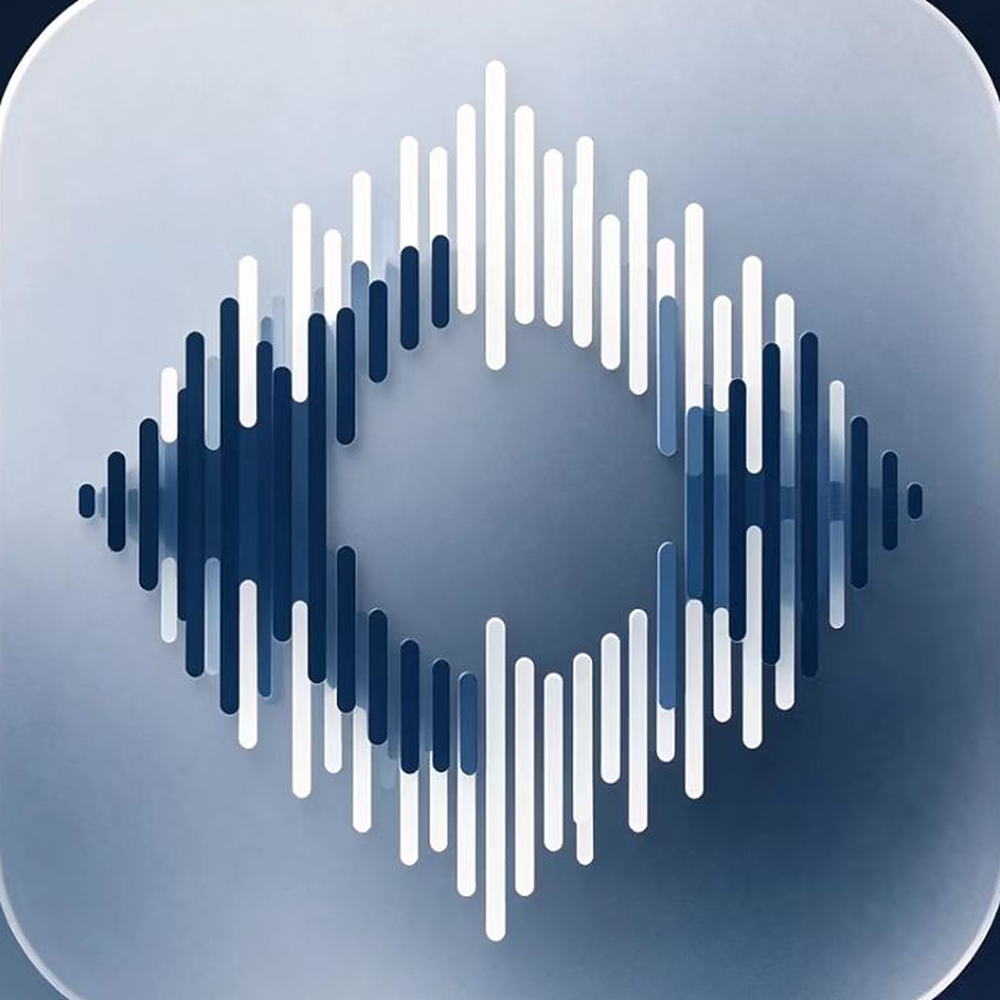
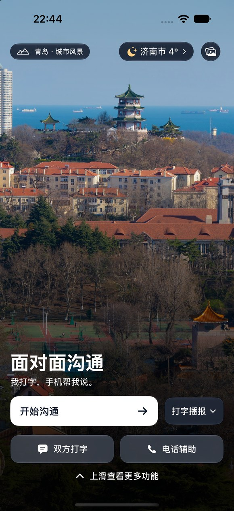
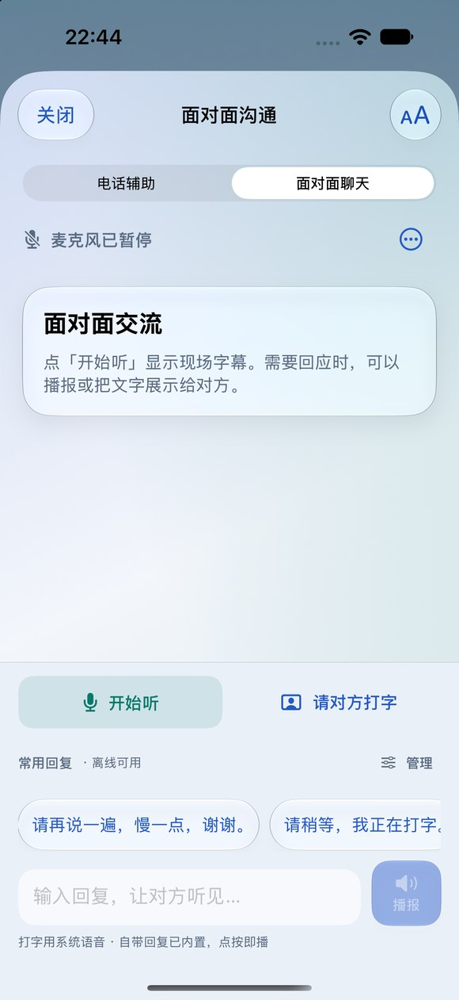
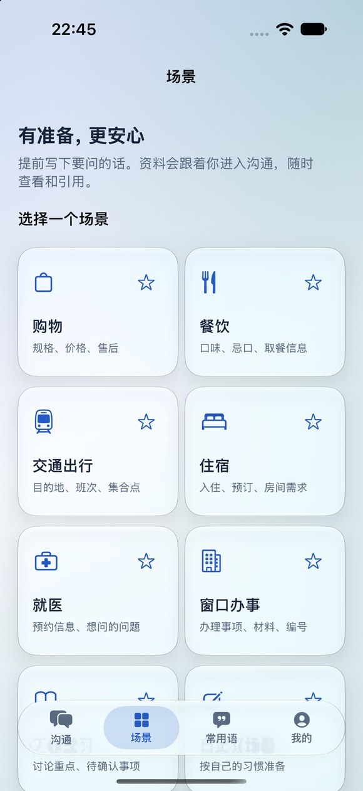

# 译声 · EchoLoom

**你打字，手机帮你说；对方开口，你可以看字幕。** 译声是为听障人士设计的 iPhone 沟通工具。在诊室可以边看字幕边回答，在安静的会议室可以两个人轮流打字，给酒店前台打电话前，也可以先准备一句开场白。对方不需要安装译声。

**[下载 3.0 正式版](https://github.com/NikaL-Li/EchoLoom/releases/tag/v3.0)** · [查看历代版本与介绍](#从译诊到译声) · [使用与编译](#下载与运行) · [开发团队](#谁在维护译声)

**iPhone · iOS 18.2 起 · SwiftUI · 3.0（build 15）**。Release 同时提供源码、未签名 IPA 和 SHA-256 校验文件。

| 沟通首页 | 面对面沟通 | 场景准备 |
| :---: | :---: | :---: |
|  |  |  |

以上为 3.0 的 iPhone 模拟器截图。首页风景和天气会变化；照片出处见[四城图库](wallpaper/README.md)。

## 一次对话怎么开始

| 你现在想做什么 | 在译声里怎么做 |
| --- | --- |
| **在柜台听清对方，再回答** | 首页点「开始沟通」。默认是打字播报；想看现场字幕时点「开始听」。临时输入用系统语音直接念出，常用回复常驻在输入框上方，播报状态也能用眼睛确认。 |
| **在安静的地方轮流聊** | 点「双方打字」，轮流把手机递给对方。这个模式不需要麦克风，也不会自动播报。只想展示一句话时，可以用沟通卡。 |
| **打电话给酒店或熟人** | 点「电话辅助」，输入号码或从通讯录选人。可准备默认开场，也可给常用联系人单独设置。开启自动开场后，符合条件的去电接通并经过设定等待时间，且系统允许添加音频时才会播报。 |

**电话里有两个不同的开关。** 想**看对方说什么**，需要开启 iPhone 的「实时字幕」；想**让对方听见你打的字**，需要系统允许「通话中添加音频」。译声不读取通话对端音轨。初次引导和电话辅助都有带设置截图的教程，在「我的」可以重看；可用性取决于设备、系统、语言和地区。

## 出门前准备好，到现场直接用

- **场景资料跟着对话走。** 例如去医院前，在「就医」里把要问的问题一行写一条。到了诊室可以逐条引用；填过地点或完整电话，还能跳转地图或拨号。内置购物、餐饮、交通出行、住宿、就医、窗口办事、工作学习，也可以自定义场景。
- **常说的话只准备一次。** 16 条内置回复随 App 附带男女声，第一次使用也能离线播放。添加自己的句子时，MiMo 会生成两种声音并保存在本机，成功后只提示、不自动播放。内置句和自定义句能一起排序。
- **保留自己需要的工具。** 首页上滑可以查看其他入口；外出时可看天气和城市风景。青岛、济南、上海、北京各有每日五景，未覆盖的城市或无网时显示随包青岛照片。需要配送工具的人还可开启骑手场景。

**离线与隐私：** 双方打字、沟通卡、已保存资料和已生成的语音无需联网。首次生成自定义语音会把该句文字交给语音服务；天气、远程图库和骑手截图识别也需要网络。面对面转写取决于系统支持与权限。场景资料和对话由你主动保存，译声不保存现场或通话录音。

## 从译诊到译声

**[打开全部版本 Releases](https://github.com/NikaL-Li/EchoLoom/releases)**。每个版本都有独立的功能介绍和源码。前三版是按交付文件回溯整理的历史版本；3.0 另提供未签名 IPA。

| 版本与说明 | 贡献者 | 这次迭代带来了什么 |
| --- | --- | --- |
| [v0.1.0 · 「译诊」网页原型](https://github.com/NikaL-Li/EchoLoom/releases/tag/v0.1.0) | hejioxue | 在浏览器里完成就医听写、打字播报、面对面大字展示和会话回顾。 |
| [v1.0.0 · 五人协作 · 原生功能分包](https://github.com/NikaL-Li/EchoLoom/releases/tag/v1.0.0) | NikaL-Li、hejioxue、IREXS-JPG、dengwj-157、poguangmy | 从网页走向 SwiftUI：并行交付首页与应急亮牌、场景与术语、双向对话、记录与设置四组模块。 |
| [v2.0.0 · 原生整合 · 打通一次完整对话](https://github.com/NikaL-Li/EchoLoom/releases/tag/v2.0.0) | IREXS-JPG | 把四个模块接进同一 Xcode 工程。从选场景到保存会话可以连续完成，聊天后还可生成要点和导出记录。 |
| [v3.0 · 译声通用版 · 正式版](https://github.com/NikaL-Li/EchoLoom/releases/tag/v3.0) | NikaL-Li | 覆盖日常场景；打字播报、离线双声回复、电话开场、实时字幕教程，以及可接续导航和拨号的场景资料。 |

[各版源码标签](https://github.com/NikaL-Li/EchoLoom/tags) · [完整版本沿革](CHANGELOG.md) · [3.0 验证范围](RELEASE-3.0.md)

## 下载与运行

- **下载成品：** [未签名 IPA](https://github.com/NikaL-Li/EchoLoom/releases/download/v3.0/EchoLoom-3.0-unsigned.ipa) 需要自行签名才能安装到 iPhone；[3.0 源码 ZIP](https://github.com/NikaL-Li/EchoLoom/releases/download/v3.0/EchoLoom-3.0-source.zip) 对应正式版标签。升级旧通用版时请保留原应用，卸载会删除本地资料。
- **在 Mac 上体验：** 用 Xcode 打开 `ios/Native/译声.xcodeproj`，选择 iPhone 模拟器运行。连接自己的 iPhone 时，在 Signing & Capabilities 中选择签名团队。
- **从源码打包：** 在仓库根目录运行 `python3 scripts/release.py ipa /tmp/yisheng-release`。

| 开发入口 | 去哪里看 |
| --- | --- |
| iPhone 客户端与验证 | [原生工程](ios/Native/) · [测试说明](ios/Native/Tests/README.md) |
| 自托管语音、天气、识别服务 | [后端配置](backend/README.md)；客户端的服务地址由 `YSServiceOrigin` 指定 |
| 城市照片与每日更新 | [图库、部署和照片归属](wallpaper/README.md) · [素材与许可](NOTICES.md) |

## 谁在维护译声

**仓库所有者与 3.0 维护者：[@NikaL-Li](https://github.com/NikaL-Li)。** 五人协作阶段的成员是 [@NikaL-Li](https://github.com/NikaL-Li)、[@hejioxue](https://github.com/hejioxue)、[@IREXS-JPG](https://github.com/IREXS-JPG)、[@dengwj-157](https://github.com/dengwj-157) 和 [@poguangmy](https://github.com/poguangmy)。

[按阶段查看贡献分工](AUTHORS.md) · [参与开发与发版](CONTRIBUTING.md) · [报告问题或提出建议](https://github.com/NikaL-Li/EchoLoom/issues) · [姊妹项目：译路畅通 SilentRider](https://github.com/NikaL-Li/SilentRider)
